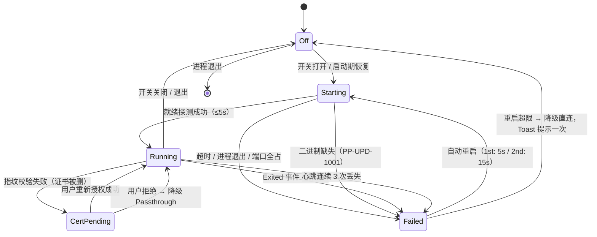
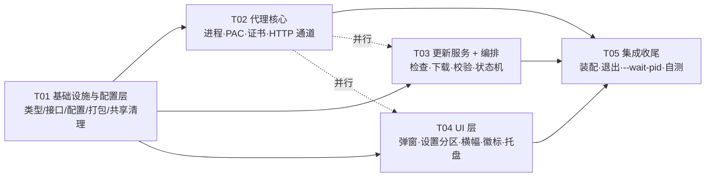

# 架构设计 · 内置 GitHub 加速代理与在线自动更新（PivotPic v1.3.0）

> 架构师：高见远　|　类型：**增量**架构设计（不改框架、不加 NuGet）
> 输入：`deliverables/pivotpic-updater/PRD.md` + 主理人两处修正 + 现有工程 `src/PivotPic`（v1.2.45）
> 目标语言：C# 12 / .NET 8 / WPF（沿用 MVVM + `AppServices` 静态服务定位器）
> 交付物：本文件 + `sequence-diagram.mermaid` + `class-diagram.mermaid`

---

## 0. 读前必看：与 PRD 的 5 处强制偏差

主理人已确认 2 处修正，另有 3 处是我基于「离线可编译 + 自保护」原则补的落地决策。**工程师按本文实现，不按 PRD 原文实现。**

| # | PRD 原文 | 本文设计 | 理由 |
|---|---|---|---|
| **D1** | §2.3 默认「只服务本进程」，系统级 PAC 为可选高级开关（默认关） | **加速 = 系统 PAC 分流（默认开启）**；「仅基础模式」（进程内代理、零系统写入）为降级选项 | 主理人修正 #1，用户明确选择 |
| **D2** | §4.2 三级非模态提示（托盘气泡 + 横幅 + 徽标） | **发现新版本弹一次模态「更新详情」**；用户点「稍后」后同版本不再弹，改由横幅常驻入口 | 主理人修正 #2，用户原话「弹窗提醒」 |
| **D3** | §2.2 非目标 #5「未授权不写任何系统级设置」 vs §2.3 允许开关 PAC | **PAC 与根证书共用同一张授权卡片、同一条 consent 记录**（`CertConsent`）。未授权 = 基础模式 = 零系统写入 | 调和 PRD 内部矛盾；用户只被问一次，知情权完整 |
| **D4** | §4.4 下载到 `%TEMP%\PivotPic\update\...` | 下载到 **`AppPaths.DataRoot\update\`**（`{安装目录}` 或 `%AppData%\PivotPic`） | `%TEMP%` 会被清理工具/重启策略清空，143 MB 重新下载代价高；DataRoot 同样在用户域，且卸载器可一并清理、支持「下载完成后重启续装」 |
| **D5** | §9.1 仓库地址与资产命名待定 | 集中到 `UpdateDefaults` 单个常量类，**资产匹配用宽松规则**（`checksums.txt` 内的 `*Setup*{version}*.exe` → 首个 >50 MB 的 `.exe`） | 现有 `build-release.ps1` 产出的实际文件名是 `正画-Setup-{version}.exe`（含中文），硬编码英文名必然失配 |

---

## 1. 现状勘察结论（已核实，工程师可直接依赖）

| 事实 | 位置 | 对本设计的影响 |
|---|---|---|
| `SchemaVersion` 当前 = **3**（`ConfigService.CurrentSchemaVersion` 是 `private const`） | `Services/ConfigService.cs:26` | 新增到 4，迁移逻辑必须写在 `Sanitize()` 里（**唯一**的配置清洗入口） |
| 配置反序列化走 `AppServices.JsonOptions`（大小写不敏感、允许注释与尾逗号） | `Services/Contracts.cs:131` | 新字段缺失自动取属性默认值 → 迁移只需处理「不能沿用默认值」的项 |
| `AppPaths.DataRoot` = 安装目录可写则用之，否则 `%AppData%\PivotPic` | `Services/AppPaths.cs:17` | **`DataRoot\proxy\` 恒可写**，正好满足 gitport「exe 必须放可写目录」的硬约束 |
| 版本号唯一来源 `AppInfo.VersionText / Version`（从程序集读 `Major.Minor.Build`） | `Services/AppInfo.cs` | 更新比较直接 `Version.TryParse(AppInfo.Version)`，**不新增版本常量** |
| 服务定位器 `AppServices` 是静态属性 | `Services/Contracts.cs:119` | 新服务加静态槽位，不引入 DI 容器 |
| **日志列顺序是硬契约**：`时间\t级别\t目录\t文件名\t尺寸\t动作\t耗时\t说明`；`MonitorPage` 用 `Split('\t')[5]`（动作列）匹配 `Rotated`/`ExifRewritten` 统计「今日处理」 | `Models/AppConfig.cs:207`、`Views/MonitorPage.xaml.cs:923,1007` | 新增日志的动作列 token **绝不能**是 `Rotated`/`ExifRewritten`；本文统一用英文 token（见 §9.2） |
| `MainWindow` 根 Grid 只有 3 行：`48 / * / 32`，状态条在 Row 2，`ToastLayer` 在 Row 0 `RowSpan=3` | `MainWindow.xaml:32-36,146,171` | 插入横幅需要加一行：`48 / * / Auto / 32`，**状态条移到 Row 3，ToastLayer 改 `RowSpan=4`** |
| `RequestExit()` 是**同步**的，内部 `Application.Current.Shutdown(0)` | `MainWindow.xaml.cs:442` | 必须异步化，否则优雅关代理（≤3s）会卡住 UI |
| 设置页写入模式：`_loading` 标志 + `FillXxx()` + `OnConfigChanged` 重入保护 | `Views/SettingsPage.xaml.cs:218,262` | 新分区沿用同一模式，避免刷新风暴 |
| 对话框约定：`WindowStyle=None` + `AllowsTransparency` + `Background=Transparent` + 外层 24px 透明边距 + `ScaleTransform 0.94` 入场 | `Views/AddFolderDialog.xaml:1-30` | 新的两个对话框沿用此约定 |
| 安装器 `--silent-install` 已存在，参数解析在 `Setup/App.xaml.cs:RunSilentInstall`；`Installer.Install` 里已有 `KillRunningInstances()` 兜底 | `src/PivotPic.Setup/**` | `--wait-pid` 作为「优雅等待」，`KillRunningInstances` 保留为兜底 |
| 安装包最终名 `dist/正画-Setup-{version}.exe`；载荷是 `dist/app` 整目录打成 `payload/app.zip` 再内嵌 | `build-release.ps1:74-97` | 只要把 gitport 放进 `dist/app/proxy/`，安装后自然落到 `{安装目录}\proxy\`，**安装器代码无需改动解压逻辑** |
| `third_party/` 目前只有 `vips/`，**没有 gitport** | `third_party/` | ⚠️ 打包脚本必须「缺失只警告不失败」，否则离线环境构建直接挂（§10 R1） |

---

## 2. 模块划分

```
                       ┌──────────────────────────────────────────┐
   UI 层（WPF）         │ UpdateDialog  CertConsentDialog           │
                       │ SettingsPage · 状态栏横幅 · 关于页徽标      │
                       │ 托盘菜单/气泡                              │
                       └───────────────┬──────────────────────────┘
                                       │ 只订阅事件 + 调 async 方法（永不阻塞）
                       ┌───────────────▼──────────────────────────┐
   编排层               │ UpdateCoordinator                         │
                       │ 状态机聚合 · 启动调度 · 退出顺序 · 授权门    │
                       └──┬────────┬────────┬────────┬─────────────┘
                          │        │        │        │
       ┌──────────────────▼┐ ┌─────▼─────┐ ┌▼──────────────┐ ┌▼──────────────┐
   能力层 GitPortService  │ │PacService │ │CertificateSvc  │ │UpdateService   │
         进程生命周期      │ │PAC 备份/  │ │ca.crt → store  │ │检查/下载/校验/  │
         端口探测/心跳     │ │校验/还原  │ │指纹校验/移除    │ │换源/拉起安装器  │
         崩溃重启/优雅退出 │ │残留自愈   │ │               │ │               │
       └────────┬──────────┘ └───────────┘ └───────────────┘ └───────┬───────┘
                │                                                    │
                │ 写 settings.json                          ┌────────▼──────────┐
                ▼                                          │ProxyHttpClientProv│
        ┌──────────────────┐                                │ 代理 / 直连 两条    │
        │ gitport-github   │◄──────── 127.0.0.1:7810 ───────│ HttpClient 通道     │
        │ .exe -headless   │                                └────────────────────┘
        └──────────────────┘
```

**分层铁律**

1. **能力层（Services 中的 5 个新服务）不引用任何 WPF 类型**（不含 `Dispatcher`/`MessageBox`/`Window`）。它们只发事件。
2. **编排层 `UpdateCoordinator` 也不引用 WPF**，但允许调 `AppServices.Tray`（既有服务，本身已封装 WinForms）。
3. **UI 层单向依赖编排层**，所有事件回调一律 `Dispatcher.BeginInvoke` 回 UI 线程，且**必须**在 `Unloaded`/`Closed` 里退订。
4. 全部新服务在 `AppServices` 里声明为**可空**（`IUpdateCoordinator?`），调用点一律 `?.`。这是自保护的核心（§10 R6）：更新模块任何一部分构造失败，主程序照常启动。

---

## 3. 文件清单

### 3.1 新增（15 个）

| # | 相对路径 | 职责 | 约 LOC |
|---|---|---|---|
| N1 | `src/PivotPic/Models/UpdateModels.cs` | 枚举、DTO、`ProxyStatus`/`CertStatus`/`ReleaseInfo`/`DownloadProgress`/`PacSnapshot`、`UpdateErrorCodes` | 320 |
| N2 | `src/PivotPic/Services/GitPortPaths.cs` | proxy 工作目录解析、二进制就位（复制 + SHA256 校验）、`settings.json` 读写、日志重定向文件路径 | 200 |
| N3 | `src/PivotPic/Services/GitPortService.cs` | 进程生命周期、端口探测、就绪探测、心跳、崩溃重启（≤2 次）、优雅退出 | 480 |
| N4 | `src/PivotPic/Services/PacService.cs` | PAC 快照捕获、指向校验、按条件还原、残留自愈 | 260 |
| N5 | `src/PivotPic/Services/CertificateService.cs` | `ca.crt` 解析、`CurrentUser\Root` 安装/按指纹校验/移除、`cert.json` 落盘 | 280 |
| N6 | `src/PivotPic/Services/ProxyHttpClientProvider.cs` | 代理/直连两条 `HttpClient`、端口变更失效、统一 UA/超时 | 140 |
| N7 | `src/PivotPic/Services/UpdateService.cs` | `releases/latest` 检查、ETag 缓存、版本比较、多源下载 + 断点续传 + 进度、SHA256 校验、拉起安装器、临时目录清理 | 620 |
| N8 | `src/PivotPic/Services/UpdateCoordinator.cs` | 五态状态机、启动调度（延迟 5s + 24h）、授权门、退出顺序、托盘/横幅/弹窗派发 | 520 |
| N9 | `src/PivotPic/Views/UpdateDialog.xaml` `.xaml.cs` | 更新详情模态窗（详情/下载/校验/就绪/失败五态） | 260 + 380 |
| N10 | `src/PivotPic/Views/CertConsentDialog.xaml` `.xaml.cs` | 授权卡片（PRD §5 文案 + PAC 第 4 条要点） | 160 + 120 |
| N11 | `src/Shared/ProxyCleanup.cs` | 卸载期清理：还原 PAC、删证书、结束 gitport 进程（**链接进 3 个工程**，见 3.4） | 200 |
| N12 | `third_party/gitport/LICENSE-APACHE-2.0.txt` | Apache-2.0 全文（合规必带） | — |
| N13 | `third_party/gitport/NOTICE.txt` | 第三方声明：名称、版本、来源 URL、许可证、用途 | — |
| N14 | `third_party/gitport/version.json` | `{ "name":"gitport-github", "version":"x.y.z", "sha256":"...", "source":"https://..." }` | — |
| N15 | `third_party/gitport/gitport-github.exe` | **外部放入，不入版本库**（见 §10 R1） | ≈7 MB |

### 3.2 修改（13 个）

| # | 相对路径 | 改动点 |
|---|---|---|
| M1 | `src/PivotPic/Models/AppConfig.cs` | `AppConfig` 追加 13 个字段（§4.4） |
| M2 | `src/PivotPic/Services/ConfigService.cs` | `CurrentSchemaVersion` 3 → **4**；`Sanitize()` 加 v3→v4 迁移与字段夹取 |
| M3 | `src/PivotPic/Services/Contracts.cs` | 5 个新接口 + `AppServices` 6 个新可空槽位 + `TrayState` 增 `ProxyError`（可选） |
| M4 | `src/PivotPic/App.xaml.cs` | 服务装配（`Tray` 之后）+ `_ = coordinator.InitializeAsync()` + `OnExit` 兜底清理（≤4s） |
| M5 | `src/PivotPic/MainWindow.xaml` | 根 Grid 4 行；新增横幅 `Border`（Row 2）；状态条移到 Row 3；`ToastLayer` `RowSpan=4` |
| M6 | `src/PivotPic/MainWindow.xaml.cs` | `RequestExit()` 异步化；`ShowUpdateBanner/HideUpdateBanner`；版本号旁「有更新」徽标；退出时先 `PrepareForExitAsync` |
| M7 | `src/PivotPic/Views/SettingsPage.xaml` | 「启动」与「配置」之间插入「更新与网络」卡片（PRD §6 布局） |
| M8 | `src/PivotPic/Views/SettingsPage.xaml.cs` | 新分区 6 个事件处理 + `RefreshUpdateSection()` 状态刷新 + 订阅 `ProxyStatusChanged` |
| M9 | `src/PivotPic/Views/AboutPage.xaml` `.xaml.cs` | 版本号右侧「有更新」徽标（`Badge.Accent`），点击打开 `UpdateDialog` |
| M10 | `src/PivotPic/Services/TrayService.cs` | 菜单新增「检查更新 / 有更新 vX.Y.Z」项 + 发现新版本气泡（一次性） |
| M11 | `src/PivotPic/PivotPic.csproj` | `None Include="..\Shared\ProxyCleanup.cs" Link="Services\ProxyCleanup.cs"`；`Content Include="proxy\**"`（可选，用于绿色版） |
| M12 | `src/PivotPic.Setup/Installer.cs` `.App.xaml.cs`、`src/PivotPic.Uninstaller/Program.cs`、两个 `.csproj` | `--wait-pid`；卸载/卸载器清理；`Shared` 链接 |
| M13 | `build-release.ps1` | 把 gitport + 许可 + version.json 拷进 `dist/app/proxy/`；缺失只警告 |

### 3.3 运行时目录布局（新增，全部在 `AppPaths.DataRoot` 下）

```
{DataRoot}\
├─ proxy\                              ← gitport 工作目录（恒可写）
│  ├─ gitport-github.exe               ← 从 {安装目录}\proxy\ 复制而来（首次运行/版本变化时）
│  ├─ ca.crt  ca.key                   ← gitport 首次运行生成
│  ├─ routes.json                      ← gitport 管；我们不改（D-note：换源在 N7 里做，见 §6.4）
│  ├─ settings.json                    ← 我们只改 mitm / githubPAC，其余键原样保留
│  ├─ proxy.log                        ← gitport 的 stdout/stderr 重定向
│  ├─ cert.json                        ← 我们写：{thumbprint, subject, notAfterUtc, installedUtc}
│  ├─ pac-backup.json                  ← 我们写：PAC 还原快照（崩溃残留自愈用）
│  ├─ LICENSE-gitport.txt
│  └─ NOTICE-gitport.txt
├─ update\
│  ├─ latest.json                      ← Release 响应原文（离线可用）
│  ├─ latest.etag                      ← If-None-Match 值
│  └─ pending.json                     ← 已下载 + 校验通过的包（重启后续装）
└─ update-tmp\
   ├─ 正画-Setup-1.3.0.exe.part        ← 下载中（可续传）
   ├─ 正画-Setup-1.3.0.exe             ← 校验通过后落名
   └─ checksums.txt
```

> **为什么不写 `routes.json`**：我们的下载器（N7）自带三源切换 + 进度 + 续传 + 失败换源，gitport 内建镜像（`mirrors_big/small`）会引入第二套重试语义，出问题无法归因。保持 gitport 纯透传，职责单一。P2 若要做「代理节点测速择优」再回来写 `routes.json`。

### 3.4 `src/Shared/ProxyCleanup.cs` 的三处链接

`PivotPic.Uninstaller` 与 `PivotPic.Setup` 是两个**独立可执行**，不能引用主程序程序集（会把 143 MB 依赖拉进去）。但三处都需要「还原 PAC + 删证书 + 杀 gitport」。用**链接编译**而非新工程：

```xml
<!-- 三个 csproj 各加一行 -->
<ItemGroup>
  <Compile Include="..\Shared\ProxyCleanup.cs" Link="Services\ProxyCleanup.cs" />
</ItemGroup>
```

文件内只用 BCL（`Microsoft.Win32.Registry`、`X509Store`、`Process`、`System.Text.Json`），不引用 `PivotPic.Models`。

---

## 4. 数据结构与接口

### 4.1 枚举

```csharp
namespace PivotPic.Models;

/// <summary>代理工作模式。Off = 用户关闭；Passthrough = 纯转发（无证书、可无 PAC）；Mitm = 解密转发（需根证书）。</summary>
public enum ProxyMode { Off, Passthrough, Mitm }

/// <summary>增强加速（PAC + 根证书）的一次性授权记录。作为 PAC 与证书的共同前置条件（D3）。</summary>
public enum CertConsent { None, Granted, Declined }

/// <summary>代理五态（PRD §3.2）。</summary>
public enum ProxyState { Off, Starting, Running, CertPending, Failed }

/// <summary>代理失败归因，用于 UI 文案与日志归类，避免到处传字符串。</summary>
public enum ProxyFailureKind
{
    None, BinaryMissing, BinaryNotWritable, PortsExhausted, StartTimeout,
    HealthLost, CrashLoop, PacWriteFailed, PacOverridden, Unknown
}

/// <summary>一次检查的结论。</summary>
public enum UpdateCheckStatus { Ok, Latest, Found, NotModified, RateLimited, NetworkError, HttpError, ParseError, Disabled, InProgress }

/// <summary>下载通道，透明展示给用户（PRD §4.3「加速来源」）。</summary>
public enum DownloadSource { Proxy, Mirror, Direct }

/// <summary>更新流程阶段，驱动 UpdateDialog 的视觉状态。</summary>
public enum UpdateStage { Idle, Checking, Available, Downloading, Verifying, ReadyToInstall, Launching, Cancelled, Failed }

/// <summary>HTTP 客户端通道。</summary>
public enum ProxyRoute { Proxy, Direct }

/// <summary>PAC 状态。Active = 当前 PAC 指向我们；Overridden = 被别的软件改走。</summary>
public enum PacState { Unknown, Inactive, Active, Overridden, RestoreFailed }
```

### 4.2 值对象与 DTO

```csharp
namespace PivotPic.Models;

/// <summary>代理状态快照。不可变，事件回调里传的就是它，UI 只读不写。</summary>
public sealed record ProxyStatus(
    ProxyState State,
    ProxyMode Mode,
    int ProxyPort,
    int WebUiPort,
    ProxyFailureKind Failure,
    string? Detail,
    int RestartAttempts,
    bool PacActive,
    DateTime TimestampUtc)
{
    public static ProxyStatus Off { get; } = new(ProxyState.Off, ProxyMode.Off, 0, 0,
        ProxyFailureKind.None, null, 0, false, DateTime.UtcNow);

    /// <summary>本进程 HttpClient 是否可走代理。</summary>
    public bool IsUsable => State is ProxyState.Running or ProxyState.CertPending;

    /// <summary>设置页展示用：● 加速中 · 127.0.0.1:7810 / 加速中（增强）</summary>
    public string DisplayText => State switch
    {
        ProxyState.Off       => "未启用",
        ProxyState.Starting  => "启动中…",
        ProxyState.Running   => Mode == ProxyMode.Mitm ? "加速中（增强）" : $"加速中 · 127.0.0.1:{ProxyPort}",
        ProxyState.CertPending => "待授权，当前为基础加速",
        _                    => Failure switch
        {
            ProxyFailureKind.PortsExhausted => "端口被占用，已改用直连",
            ProxyFailureKind.BinaryMissing  => "加速组件缺失，已改用直连",
            _                               => "加速不可用，已改用直连"
        }
    };
}

/// <summary>证书状态。</summary>
public sealed record CertStatus(
    bool Trusted,
    string Thumbprint,
    string? Subject,
    CertFailure Failure,
    string? Detail)
{
    public static CertStatus Unknown { get; } =
        new(false, string.Empty, null, CertFailure.None, null);
}

public enum CertFailure
{
    None, NotRequested, NoConsent, CaFileMissing, CaFileInvalid,
    NotCaCertificate, StoreWriteDenied, ThumbprintMismatch, RemoveFailed
}

/// <summary>授权令牌：唯一合法来源是 CertConsentDialog 的用户点击。能力层见 token 才动手（D3）。</summary>
public readonly record struct CertConsentToken(bool Granted)
{
    public static CertConsentToken Denied => new(false);
    /// <summary>仅允许由 UI 的「同意并启用」按钮调用，禁止在服务内部凭空构造。</summary>
    public static CertConsentToken FromUserAction(bool agreed) => new(agreed);
}

/// <summary>Release 资产。</summary>
public sealed record ReleaseAsset(string Name, long Size, string DownloadUrl);

/// <summary>一次 GitHub Release。</summary>
public sealed record ReleaseInfo(
    string TagName,
    Version Version,
    DateTimeOffset? PublishedAtUtc,
    string Body,
    IReadOnlyList<ReleaseAsset> Assets)
{
    public string VersionText => "v" + Version.ToString(3);

    public string PublishedText => PublishedAtUtc is { } t
        ? t.ToLocalTime().ToString("yyyy-MM-dd") : "—";

    /// <summary>符合 UpdateDefaults 匹配规则的 Setup 资产（宽松匹配，见 D5）。</summary>
    public ReleaseAsset? SetupAsset { get; init; }

    /// <summary>可选的 checksums.txt 资产。</summary>
    public ReleaseAsset? ChecksumsAsset { get; init; }

    public string SizeText => SetupAsset is null ? "—"
        : SetupAsset.Size >= 1024L * 1024 * 1024
            ? $"{SetupAsset.Size / 1024d / 1024 / 1024:F2} GB"
            : $"{SetupAsset.Size / 1024d / 1024:F1} MB";
}

/// <summary>检查结果。</summary>
public sealed record UpdateCheckResult(
    UpdateCheckStatus Status,
    ReleaseInfo? Release,
    bool IsNewer,
    string? Message,
    TimeSpan? RateLimitReset,
    bool FromCache)
{
    public string ResultToken => Status switch   // 写入 AppConfig.LastCheckResult
    {
        UpdateCheckStatus.Found        => "found",
        UpdateCheckStatus.Latest       => "latest",
        UpdateCheckStatus.NotModified  => "latest",
        UpdateCheckStatus.RateLimited  => "rate-limited",
        UpdateCheckStatus.Disabled     => "disabled",
        _                              => "failed"
    };
}

/// <summary>下载进度快照（UI 侧按 100ms 节流消费）。</summary>
public sealed record DownloadProgress(
    long BytesReceived,
    long? TotalBytes,
    double BytesPerSecond,
    TimeSpan? Eta,
    DownloadSource Source,
    int Attempt)
{
    public double Percent => TotalBytes is > 0
        ? Math.Clamp((double)BytesReceived / TotalBytes.Value, 0, 1) : 0;

    public string SpeedText => BytesPerSecond >= 1024 * 1024
        ? $"{BytesPerSecond / 1024 / 1024:F1} MB/s"
        : $"{BytesPerSecond / 1024:F0} KB/s";

    public string SourceText => Source switch
    {
        DownloadSource.Proxy  => "内置加速",
        DownloadSource.Mirror => "第三方加速",
        _                     => "直连"
    };
}

/// <summary>校验通过、可执行的安装包。</summary>
public sealed record PreparedPackage(string FilePath, string Sha256, long Size, bool Verified);

/// <summary>PAC 还原快照。落到 pac-backup.json，异常退出后下次启动可自愈。</summary>
public sealed record PacSnapshot(
    string? AutoConfigUrl,
    string? ProxyEnable,
    string? ProxyServer,
    DateTime CapturedUtc);

/// <summary>可提示的新版本。</summary>
public sealed record UpdateAvailability(ReleaseInfo Release, bool Skipped);

/// <summary>错误码。日志里固定输出 <c>PP-UPD-xxxx</c>，便于用户报障时定位。</summary>
public static class UpdateErrorCodes
{
    public const string BinaryMissing      = "PP-UPD-1001";
    public const string BinaryNotWritable  = "PP-UPD-1002";
    public const string PortsExhausted     = "PP-UPD-1003";
    public const string StartTimeout       = "PP-UPD-1004";
    public const string HealthLost         = "PP-UPD-1005";
    public const string CrashLoop          = "PP-UPD-1006";
    public const string CaFileMissing      = "PP-UPD-1101";
    public const string CaFileInvalid      = "PP-UPD-1102";
    public const string CertStoreDenied    = "PP-UPD-1103";
    public const string CertMismatch       = "PP-UPD-1104";
    public const string PacCaptureFailed   = "PP-UPD-1201";
    public const string PacRestoreFailed   = "PP-UPD-1202";
    public const string RateLimited        = "PP-UPD-1301";
    public const string NetworkFailed      = "PP-UPD-1302";
    public const string ParseFailed        = "PP-UPD-1303";
    public const string NoDiskSpace        = "PP-UPD-1401";
    public const string AllSourcesFailed   = "PP-UPD-1402";
    public const string ChecksumMismatch   = "PP-UPD-1403";
    public const string LaunchFailed       = "PP-UPD-1404";
}

/// <summary>更新模块的编译期常量。</summary>
public static class UpdateDefaults
{
    /// <summary>⚠️ 待 PRD §9.1 确认后替换。</summary>
    public const string Repository = "pengfei-jiao/PivotPic";

    public const string ApiLatest = "https://api.github.com/repos/{0}/releases/latest";
    public const string ChecksumsAssetName = "checksums.txt";

    /// <summary>第三方加速前缀，按顺序尝试。</summary>
    public static readonly string[] MirrorPrefixes = { "https://gh-proxy.com/" };

    public const int ProxyPortStart = 7810;
    public const int ProxyPortEnd   = 7819;
    public const int WebUiPortStart = 7811;
    public const int WebUiPortEnd   = 7819;

    public const int ReadyTimeoutMs      = 5000;
    public const int HeartbeatSeconds    = 30;
    public const int HeartbeatMissLimit  = 3;
    public const int GracefulStopMs      = 3000;
    public static readonly TimeSpan[] RestartBackoff = { TimeSpan.FromSeconds(5), TimeSpan.FromSeconds(15) };

    /// <summary>启动后延迟多久跑第一次静默检查。PRD 写 5s，本文取 20s（避开启动高峰，见 §6.1）；可调。</summary>
    public const int StartupCheckDelaySeconds = 20;
    public const int MinDiskHeadroomFactor    = 2;
    public const int MaxSourceAttempts        = 3;
}
```

### 4.3 服务接口

```csharp
namespace PivotPic.Services;

// ───────────────────────── 代理进程托管 ─────────────────────────
public interface IGitPortService : IAsyncDisposable
{
    ProxyStatus Status { get; }
    event EventHandler<ProxyStatus>? StatusChanged;

    string WorkingDirectory { get; }
    string BinaryPath { get; }
    string CaCertPath { get; }

    /// <summary>确保二进制就位（必要时从安装目录复制）+ 探端口 + 写 settings.json + 拉起进程 + 等就绪。</summary>
    /// <remarks>不抛异常：失败通过返回的 ProxyStatus(Failed) 表达，调用方不需要 try。</remarks>
    Task<ProxyStatus> StartAsync(ProxyMode mode, CancellationToken ct);

    /// <summary>改模式：写 settings.json 后重启进程（gitport 只在启动时读配置，必须重启才生效）。</summary>
    Task<ProxyStatus> ApplyModeAsync(ProxyMode mode, CancellationToken ct);

    /// <summary>优雅退出：管理接口 → 等 3s → 超时 Kill(entireProcessTree)。幂等。</summary>
    Task StopAsync(CancellationToken ct);

    /// <summary>取消挂起的自动重启（用户手动关闭开关时调用）。</summary>
    void CancelPendingRestart();

    /// <summary>一次性健康探测（管理页 GET），供设置页「立即检测」与退出前确认使用。</summary>
    Task<bool> PingAsync(CancellationToken ct);
}

// ───────────────────────── PAC（系统分流） ─────────────────────────
public interface IPacService
{
    PacState State { get; }
    event EventHandler<PacState>? StateChanged;

    /// <summary>记录「开启前」的 PAC 快照并落盘。已有快照时不覆盖（除非快照已失效）。</summary>
    Task<bool> CaptureBaselineAsync(CancellationToken ct);

    /// <summary>校验当前 PAC 是否仍指向 127.0.0.1:{webUiPort}。</summary>
    Task<PacState> VerifyAsync(int webUiPort, CancellationToken ct);

    /// <summary>按条件还原：仅当当前 PAC 仍指向我们才写回快照，避免覆盖 VPN 的 PAC。幂等。</summary>
    Task<bool> RestoreAsync(CancellationToken ct);

    /// <summary>启动期自愈：若快照存在且当前 PAC 指向我们（上次异常退出残留）→ 还原。</summary>
    Task<bool> HealResidualAsync(CancellationToken ct);
}

// ───────────────────────── 证书 ─────────────────────────
public interface ICertificateService
{
    CertStatus Status { get; }
    event EventHandler<CertStatus>? StatusChanged;

    string CaCertPath { get; }

    /// <summary>只读：按 ca.crt 指纹查 CurrentUser\Root。</summary>
    Task<CertStatus> RefreshAsync(CancellationToken ct);

    /// <summary>写入当前用户根存储。未授权时直接返回 NoConsent，绝不写系统（D3 硬保证）。</summary>
    Task<CertStatus> InstallAsync(CertConsentToken consent, CancellationToken ct);

    /// <summary>按指纹移除。幂等（不存在也算成功）。</summary>
    Task<CertStatus> RemoveAsync(CancellationToken ct);
}

// ───────────────────────── HTTP 通道 ─────────────────────────
public interface IProxyHttpClientProvider : IDisposable
{
    ProxyRoute CurrentRoute { get; }

    /// <summary>启动代理/端口变更/关闭代理时调用，使旧连接池失效。</summary>
    void Invalidate(int? proxyPort);

    /// <summary>取一个通道对应的 HttpClient。同一通道复用实例（连接池复用）。</summary>
    HttpClient Get(ProxyRoute route);
}

// ───────────────────────── 更新 ─────────────────────────
public interface IUpdateService
{
    UpdateStage Stage { get; }
    event EventHandler<DownloadProgress>? DownloadProgressChanged;
    event EventHandler<UpdateStage>? StageChanged;

    string RepositorySlug { get; }

    /// <summary>检查最新版本。带 ETag 条件请求；304 直接复用缓存。</summary>
    Task<UpdateCheckResult> CheckAsync(UpdateCheckTrigger trigger, CancellationToken ct);

    /// <summary>三源切换 + 断点续传 + SHA256 校验。成功后返回 PreparedPackage。</summary>
    /// <exception cref="UpdateFailedException">全部源失败 / 空间不足 / 校验不符（带错误码）。</exception>
    Task<PreparedPackage> DownloadAndVerifyAsync(
        ReleaseInfo release, IProgress<DownloadProgress>? progress, CancellationToken ct);

    /// <summary>以 --wait-pid 拉起 Setup。返回 true 表示进程已成功创建。</summary>
    Task<bool> LaunchInstallerAsync(PreparedPackage package, CancellationToken ct);

    /// <summary>清理 update-tmp。keepForDiagnostics=true 时保留 24h（PRD §4.5）。</summary>
    void CleanupTemp(bool keepForDiagnostics);
}

public enum UpdateCheckTrigger { Startup, Periodic, Manual, AfterProxyReady }

/// <summary>更新失败异常：带错误码，UI 直接映射文案。</summary>
public sealed class UpdateFailedException : Exception
{
    public UpdateFailedException(string code, string message, Exception? inner = null)
        : base(message, inner) => Code = code;
    public string Code { get; }
}

// ───────────────────────── 编排（唯一对 UI 暴露的门面） ─────────────────────────
public interface IUpdateCoordinator : IAsyncDisposable
{
    ProxyStatus Proxy { get; }
    CertStatus Certificate { get; }
    PacState Pac { get; }
    UpdateCheckResult? LastCheck { get; }
    UpdateAvailability? Pending { get; }
    bool IsDownloading { get; }

    event EventHandler<ProxyStatus>? ProxyStatusChanged;
    event EventHandler<UpdateAvailability?>? PendingChanged;
    event EventHandler<UpdateCheckResult>? CheckCompleted;
    event EventHandler<string>? Notice;              // 一次性 Toast 文本

    /// <summary>启动：PAC 自愈 → （已授权且开关开）启代理 → 5s 后静默检查 → 起 24h 定时器。绝不抛。</summary>
    Task InitializeAsync(CancellationToken ct);

    Task<bool> SetProxyEnabledAsync(bool enabled, CancellationToken ct);
    Task<bool> SetSystemWideAsync(bool enabled, CancellationToken ct);   // 关 = 仅基础模式
    Task<CertStatus> GrantConsentAsync(CancellationToken ct);
    Task<CertStatus> RevokeCertificateAsync(CancellationToken ct);
    Task<bool> RemoveCertificateAsync(CancellationToken ct);

    Task<UpdateCheckResult> CheckNowAsync(CancellationToken ct);
    Task<PreparedPackage?> DownloadAsync(IProgress<DownloadProgress> progress, CancellationToken ct);
    void CancelDownload();
    void SuppressVersion(Version version);
    void ClearPending();

    /// <summary>按 PRD §3.4 顺序清理：取消下载/检查 → 停代理 → 还 PAC → 清临时文件。幂等，永不抛。</summary>
    Task PrepareForExitAsync(CancellationToken ct);
}
```

### 4.4 `AppConfig` 追加字段与迁移

```csharp
// Models/AppConfig.cs —— 追加到 AppConfig 类内
// ===== v1.3.0 · 更新与网络（SchemaVersion 4）=====

/// <summary>自动检查更新总开关（PRD §3.1）。</summary>
public bool AutoCheckEnabled { get; set; } = true;

/// <summary>检查间隔（小时），默认 24。P2 才暴露给用户。</summary>
public int CheckIntervalHours { get; set; } = 24;

/// <summary>上次检查 UTC 时间。</summary>
public DateTime? LastCheckUtc { get; set; }

/// <summary>上次检查结果：ok / latest / found / failed / rate-limited / disabled。</summary>
public string LastCheckResult { get; set; } = string.Empty;

/// <summary>用户选择「不再提示此版本」的版本号（形如 1.3.0）。</summary>
public string SkippedVersion { get; set; } = string.Empty;

/// <summary>网络加速开关，默认开。</summary>
public bool ProxyEnabled { get; set; } = true;

/// <summary>代理模式。Off = 用户关闭；Passthrough = 基础；Mitm = 增强。</summary>
public ProxyMode ProxyMode { get; set; } = ProxyMode.Passthrough;

/// <summary>实际代理端口（探测后回写）。</summary>
public int ProxyPort { get; set; } = 7810;

/// <summary>实际管理页端口（探测后回写）。</summary>
public int ProxyWebUiPort { get; set; } = 7811;

/// <summary>
/// 系统级 GitHub 分流（写 PAC + 证书）。
/// <para>语义已升级（D1）：默认 <c>true</c> = 主路径；置 <c>false</c> = 仅基础模式（零系统写入）。</para>
/// </summary>
public bool ProxySystemWide { get; set; } = true;

/// <summary>增强加速授权记录，同时是 PAC 与证书的前置条件（D3）。</summary>
public CertConsent CertConsent { get; set; } = CertConsent.None;

/// <summary>已安装根证书指纹（SHA-1 大写无空格）。</summary>
public string CertThumbprint { get; set; } = string.Empty;

/// <summary>首次授权引导是否走完（拒绝也算走完）。用于「只在首次弹一次」。默认 false，即使新装用户也会引导。</summary>
public bool UpdateSetupCompleted { get; set; } = false;
```

**迁移策略**（`ConfigService.Sanitize` 内，紧接现有 v2→v3 分支之后）：

```csharp
// v3 → v4：新增「更新与网络」。缺字段由属性默认值兜底，这里只处理「不能沿用默认值」的项。
if (config.SchemaVersion < 4)
{
    // 1) 老用户从未见过授权卡片 → 必须走一次引导；在此之前不允许写 PAC / 装证书。
    if (config.CertConsent != CertConsent.Granted)
    {
        config.CertConsent = CertConsent.None;
        config.ProxySystemWide = false;      // 保守：老用户先不接管系统流量
        config.ProxyMode = ProxyMode.Passthrough;
    }

    // 2) 无指纹却声称已授权 → 判定为脏数据，回到未授权。
    if (config.CertConsent == CertConsent.Granted && string.IsNullOrWhiteSpace(config.CertThumbprint))
    {
        config.CertConsent = CertConsent.None;
        config.ProxySystemWide = false;
        config.ProxyMode = ProxyMode.Passthrough;
    }

    config.UpdateSetupCompleted = false;
    config.SchemaVersion = CurrentSchemaVersion;   // → 4
}

// 夹取（任何版本都执行，防手改配置把程序弄挂）
config.CheckIntervalHours = Math.Clamp(config.CheckIntervalHours, 1, 168);
config.ProxyPort    = Math.Clamp(config.ProxyPort,    UpdateDefaults.ProxyPortStart, UpdateDefaults.ProxyPortEnd);
config.ProxyWebUiPort = Math.Clamp(config.ProxyWebUiPort, UpdateDefaults.WebUiPortStart, UpdateDefaults.WebUiPortEnd);
if (config.ProxyPort == config.ProxyWebUiPort) config.ProxyWebUiPort = config.ProxyPort + 1;

config.LastCheckResult ??= string.Empty;
config.SkippedVersion  ??= string.Empty;
config.CertThumbprint  ??= string.Empty;
if (!Version.TryParse(config.SkippedVersion.TrimStart('v','V'), out _)) config.SkippedVersion = string.Empty;
```

> **向后兼容**：新字段全部有默认值，`System.Text.Json` 对缺失键不报错；旧版本读到 v4 配置也只会忽略未知字段（`PropertyNameCaseInsensitive` + 无 `UnmappedMemberHandling` 限制）。**没有单向不可逆迁移**，可以回滚到 v1.2.45。

### 4.5 `AppServices` 新增槽位（全部可空）

```csharp
// Services/Contracts.cs
public static class AppServices
{
    // ... 既有 9 个保持不变 ...
    public static IGitPortService? GitPort { get; set; }
    public static IPacService? Pac { get; set; }
    public static ICertificateService? Certificates { get; set; }
    public static IProxyHttpClientProvider? ProxyHttp { get; set; }
    public static IUpdateService? Updates { get; set; }

    /// <summary>UI 只跟这一个门面打交道。为 null 表示更新模块装配失败，界面须整体降级隐藏。</summary>
    public static IUpdateCoordinator? UpdateCoordinator { get; set; }
}
```

> 既有的 9 个是 `null!`（硬依赖）。新增的 6 个是**可空**——这是有意的：更新模块是新代码，是唯一可能出问题的部分，绝不能因为它让主程序起不来（§10 R6）。

---

## 5. 线程模型与取消

### 5.1 线程归属

| 组件 | 运行线程 | 说明 |
|---|---|---|
| `GitPortService` | 线程池（`Task.Run` / `await` 续体） | 进程启动、就绪轮询、心跳全异步；**不加锁阻塞 UI** |
| `PacService` | 线程池 | 注册表读写是同步 API，但都是微秒级；只在 `Task.Run` 里调 |
| `CertificateService` | 线程池 | `X509Store` 操作可能弹系统框 → **必须**在后台线程，绝不在 UI 线程调（否则卡死整个界面） |
| `UpdateService` | 线程池 | 网络 + 文件 IO |
| `UpdateCoordinator` | 线程池 | 内部 `SemaphoreSlim(1,1)` 串行化状态转换 |
| 所有 `EventHandler` 的**订阅者**（UI） | 事件在**线程池**触发，订阅者自行 `Dispatcher.BeginInvoke` | 统一用 `DispatcherPriority.Background`，避免抢占图片处理 UI |
| 定时器 | `System.Threading.PeriodicTimer` | **不用** `DispatcherTimer`（服务层不能碰 WPF），**不用** `System.Timers.Timer`（重入难防） |

### 5.2 取消令牌层级

```
_appCts                       ← App.OnStartup 创建，OnExit 前 Cancel
 ├─ _proxySessionCts          ← 每次 StartAsync 新建；StopAsync/关闭开关时 Cancel
 │   └─ 就绪轮询 / 心跳循环
 ├─ _checkCts                 ← 每次 CheckAsync 新建；手动取消 / 退出时 Cancel
 └─ _downloadCts              ← 每次 DownloadAsync 新建；用户点「取消」/退出时 Cancel
```

`PrepareForExitAsync` 的取消顺序**必须**是：
1. `_downloadCts.Cancel()` + `_checkCts.Cancel()`
2. `await _downloadTask` 最多 1s（不等完成也继续，文件是 `.part`，下次会覆盖）
3. `await GitPort.StopAsync(3s)`
4. `await Pac.RestoreAsync()`
5. `CleanupTemp(keepForDiagnostics:false)`（只清本次会话产生的 `.part`，不删已校验通过的包）

### 5.3 退出路径（关键：不能阻塞 UI 线程）

```csharp
// MainWindow.xaml.cs —— 由同步改异步
public void RequestExit()
{
    if (_exiting) return;
    _exiting = true;
    _progress?.Shutdown();
    PersistWindowPlacement();
    AppServices.Config?.SaveNow();
    _ = ExitAsync();                       // fire-and-forget，内部有超时
}

private async Task ExitAsync()
{
    try
    {
        if (AppServices.UpdateCoordinator is { } c)
        {
            using var cts = new CancellationTokenSource(TimeSpan.FromSeconds(6));
            await c.PrepareForExitAsync(cts.Token).ConfigureAwait(true);
        }
    }
    catch { /* 退出阶段异常不得阻止退出 */ }

    Dispatcher.Invoke(() => Application.Current.Shutdown(0));
}
```

`App.OnExit` 保留一道**兜底**（用户从托盘 / 任务管理器外的路径退出时）：

```csharp
// App.OnExit 开头，放在 Monitor.StopAll() 之前
try
{
    if (AppServices.UpdateCoordinator is { } c)
    {
        using var cts = new CancellationTokenSource(TimeSpan.FromSeconds(4));
        c.PrepareForExitAsync(cts.Token).Wait(TimeSpan.FromSeconds(4));
    }
}
catch { }
```

---

## 6. 关键流程

### 6.1 启动期编排（`UpdateCoordinator.InitializeAsync` 完整顺序）

```
1. Pac.HealResidualAsync()                     ← 上次异常退出残留的 PAC 先还原（无感）
2. if (CertConsent == Granted) Cert.RefreshAsync()
      指纹查不到 → CertPending（不弹卡片，只置黄点）
3. if (ProxyEnabled && CertConsent == Granted && ProxySystemWide)
       → GitPort.StartAsync(Mitm) → Pac.CaptureBaselineAsync() → Pac.VerifyAsync()
   else if (ProxyEnabled)
       → GitPort.StartAsync(Passthrough)     ← 基础模式，零系统写入
   else  → Status = Off
4. 启动 24h PeriodicTimer
5. 20s 后（不是 5s，见下）跑第一次 CheckAsync(Startup)
```

> **为什么把静默检查延迟从 5s 改成 20s**：PRD 写 5s，但主程序启动后 5s 正是 libvips 加载 + 目录补扫的高峰，此时起代理进程 + HTTPS 握手会跟图片处理抢 CPU/磁盘。20s 对用户完全无感（他要看结果也得打开界面），却避开峰值。若代理启动超过 20s 仍未就绪，检查先用直连跑（`AfterProxyReady` 里不重复检查）。**这是可调常量 `UpdateDefaults.StartupCheckDelaySeconds`，若主理人坚持 5s 改回即可，不影响结构。**

### 6.2 五态状态机



**状态机硬约束**

- `Failed` 状态下 `Status.IsUsable == false` → 所有网络请求自动走 `ProxyRoute.Direct`（`ProxyHttpClientProvider.CurrentRoute` 由 coordinator 设置）。
- 重启计数在 `Running` 稳定 ≥60s 后**清零**，避免一天里偶发 3 次抖动就被判定 CrashLoop。
- `PacOverridden` 不是独立状态，而是 `Running` 上叠加的布尔标记（`ProxyStatus.PacActive=false`），UI 显示「已加速（系统分流被其它软件接管）」+ 提示链接。

### 6.3 时序图

见同目录 `sequence-diagram.mermaid`（4 张图，Mermaid `sequenceDiagram`）：
① 首次开启加速并授权　② 启动静默检查 → 下载 → 校验 → 拉起安装器 → 退出　③ 关闭开关 / 退出清理顺序　④ 代理崩溃重启与降级

### 6.4 下载源策略（`UpdateService.DownloadAndVerifyAsync`）

```
attempt 序列（最多 3 次）：
  A1: Source=Proxy   （127.0.0.1:7810，仅当 Status.IsUsable）
  A2: Source=Mirror  （https://gh-proxy.com/ + 原始 URL）
  A3: Source=Direct  （无代理）
每个 attempt 内部最多重试 1 次（同源），退避 2s / 5s。

续传：同源重试时若响应含 Accept-Ranges: bytes 且本地 .part 长度 > 0
      → 发 Range: bytes={len}- ，Append 写入。
      换源时丢弃 .part（不同源的字节流可能不一致）。
      校验失败时：删除 .part 与目标文件，attempt 计数 +1。

进度节流：81920 字节缓冲区，每 ≥100ms 或每 ≥1% 上报一次；
          速度用最近 1s 窗口的滑动平均（避免刺数）。
          完成后 Stage=Verifying → ReadyToInstall。
```

**校验策略**

| 情况 | 行为 |
|---|---|
| Release 带 `checksums.txt` 且含该资产行 | 必须匹配；不符 → 删文件 + `PP-UPD-1403` + 重试（最多 2 次）→ 仍失败只留「手动下载」 |
| Release 带 `checksums.txt` 但无该资产行 | 记 `Warn`，按 `Verified=false` 继续（UI 显示「未校验」） |
| Release 无 `checksums.txt` | 同上，`Verified=false`，`Warn` 一次 |
| 连续 2 次校验失败 | `Stage=Failed`，只显示「浏览器打开 Release 页」 |

> P1 的 Authenticode 验签（PRD §7）插在 SHA256 之后，作为 `PreparedPackage` 的第二道门；接口预留 `Verified` 字段即为它准备。

---

## 7. 设置页 / UI 设计规格

### 7.1 「更新与网络」卡片（插在「启动」与「配置」之间）

```
┌ 更新与网络 ────────────────────────────────────────────────────┐
│ 从 GitHub 检查新版本。网络不稳时自动加速，退出时自动还原。          │
│                                                                │
│ 自动检查更新      [开关]   启动时 + 每 24 小时                    │
│ 当前版本          v1.2.45                 [检查更新]             │
│ 网络加速          [开关]   ● 加速中（增强） · 127.0.0.1:7810      │
│                           （失败时附「重启」链接）                │
│ 增强加速（系统分流 + 证书）                                     │
│                   ○ 未启用    [启用增强] [移除证书]              │
│ 仅基础模式        [开关]   只让本程序走代理，不改系统设置          │
│ 上次检查          2026-11-07 09:12 · 已是最新                    │
└────────────────────────────────────────────────────────────────┘
```

- 「仅基础模式」= `ProxySystemWide` 取反。开=不写 PAC、不装证书（零系统写入）。
- 「启用增强」→ 若 `CertConsent == Declined` 也允许再次手动发起（PRD §3.3）。
- 「移除证书」→ 二次确认（复用 `MessageBox`? **不用**：新建一个小 `ConfirmDialog`？→ 简化：直接用 `CertConsentDialog` 的 `ConfirmRemove` 模式，或复用既有 `FolderSettingsDialog` 的确认样式。**决策：在 `UpdateDialog` 里加一个 `Confirm` 轻量状态，避免新增第 3 个对话框文件**）。

### 7.2 状态栏横幅（`MainWindow.xaml`）

```xml
<!-- 根 Grid.RowDefinitions 改为 4 行 -->
<RowDefinition Height="48" />   <!-- 标题栏 -->
<RowDefinition Height="*"  />   <!-- 主体 -->
<RowDefinition Height="Auto" /> <!-- ★ 新增：更新横幅 -->
<RowDefinition Height="32" />   <!-- 状态条（原 Row=2 → 现 Row=3） -->

<!-- 插在主体之后、状态条之前 -->
<Border x:Name="UpdateBanner" Grid.Row="2" Visibility="Collapsed"
        Background="{DynamicResource Accent.Soft}"
        BorderBrush="{DynamicResource Stroke.Subtle}" BorderThickness="0,1,0,0"
        Padding="20,10">
  <Grid>
    <StackPanel Orientation="Horizontal" VerticalAlignment="Center">
      <Ellipse Width="6" Height="6" Fill="{DynamicResource Accent}" VerticalAlignment="Center" />
      <TextBlock x:Name="BannerText" Margin="10,0,0,0" VerticalAlignment="Center"
                 Style="{StaticResource Typo.Body}" />
    </StackPanel>
    <StackPanel Orientation="Horizontal" HorizontalAlignment="Right">
      <Button x:Name="BtnBannerOpen" Content="查看详情" Style="{StaticResource Btn.Primary}"
              Height="28" Padding="14,0" Click="OnBannerOpenClick" />
      <Button Content="忽略" Style="{StaticResource Btn.Ghost}" Height="28" Margin="8,0,0,0"
              Click="OnBannerDismissClick" />
    </StackPanel>
  </Grid>
</Border>
```

`ToastLayer` 的 `Grid.RowSpan` 从 `3` 改为 `4`。

### 7.3 UI 设计令牌（沿用，不新增）

| 用途 | 令牌 |
|---|---|
| 卡片容器 | `Card`（含 `Radius.Card` / `Pad.Card`） |
| 主按钮 / 次按钮 / 幽灵按钮 | `Btn.Primary` / `Btn.Secondary` / `Btn.Ghost` |
| 标题 / 正文 / 次要 / 等宽 | `Typo.Title` / `Typo.Body` / `Typo.Secondary` / `Typo.Mono` |
| 状态点 | `Success`（Running）/ `Warning`（Starting·CertPending）/ `Danger`（Failed）/ `Text.Tertiary`（Off） |
| 强调 / 柔和底 | `Accent` / `Accent.Soft` |
| 徽标 | `Badge.Accent`（关于页「有更新」）、`Badge.Danger`（失败） |
| 进度条 | 原生 `ProgressBar` + `Foreground="{DynamicResource Accent}"`，`Height=6`，`CornerRadius` 用 `Radius.Pill` 包一层 `Border` 裁切 |
| 动效 | `Duration.Base`（既有值），对话框入场 `ScaleTransform 0.94→1` + `Opacity 0→1`（复刻 `AddFolderDialog`） |
| 玻璃拟态 | 对话框 `Background="{DynamicResource Bg.Flyout}"` + 外层双层阴影（复刻既有做法），**不引入 `BlurEffect`**（WPF 的 `BlurEffect` 在 `AllowsTransparency` 窗口上性能极差） |

---

## 8. 安装器 / 卸载器 / 打包脚本改动

### 8.1 `PivotPic.Setup`：`--wait-pid`

**`App.xaml.cs`（`OnStartup` 最前面）**

```csharp
// 自动更新拉起时带 --wait-pid {宿主PID}：先等旧版本退出，再显示界面/执行静默安装。
var waitPid = ReadIntArg(e.Args, "--wait-pid");
if (waitPid is > 0) Installer.WaitForProcessExit(waitPid.Value, TimeSpan.FromSeconds(20));
```

**`Installer.cs`**

```csharp
/// <summary>等待宿主进程退出。超时返回 false（调用方继续，Install 内部还有 KillRunningInstances 兜底）。</summary>
internal static bool WaitForProcessExit(int pid, TimeSpan timeout)
{
    try
    {
        using var p = Process.GetProcessById(pid);
        return p.WaitForExit((int)timeout.TotalMilliseconds);
    }
    catch (ArgumentException) { return true; }                     // 进程已不存在
    catch (Exception ex) { LogFailure("WaitForProcessExit", ex); return false; }
}
```

> **为什么同步等待而不是后台等**：正常路径下宿主在 1.5s 内退出（`PrepareForExitAsync` 的预算），界面此时还没画出来，用户看不到"卡住"。20s 是硬上限，超时立刻继续并由 `KillRunningInstances()` 兜底 —— **不会出现"装了没反应"**。
> **为什么不在 `MainWindow` 里等**：会让安装向导先画出"准备安装"再突然消失重画，观感更差。

**同时**：`Installer.UninstallCore` 开头调用 `ProxyCleanup.CleanupAll(installDir)`（还原 PAC + 删证书 + 杀 gitport），再走原有清理。

### 8.2 `PivotPic.Uninstaller`：`Program.Cleanup` 最前面

```csharp
// 必须在删除程序文件之前：proxy 工作目录在 DataRoot，可能不在 installDir 里
ProxyCleanup.CleanupAll(installDir);
StateText：正在清理加速组件与系统设置…
```

`ProxyCleanup.CleanupAll` 的 5 步（顺序不可调）：

```
1. KillProxyProcesses()          Process.GetProcessesByName("gitport-github") → Kill(tree) → WaitForExit(2s)
2. RestorePac()                  读 {DataRoot}\proxy\pac-backup.json → 仅当当前 AutoConfigURL 指向 127.0.0.1:78xx 时写回快照
3. RemoveCertificate()           读 cert.json 的 thumbprint；缺失则按 Subject/Issuer 自签 + 含 "PivotPic" 扫描兜底 → store.Remove
4. DeleteProxyDirectory()        {DataRoot}\proxy\、{DataRoot}\update-tmp\（update\latest.json 保留无害，一并删也可以）
5. DeleteUpdateDirectory()       {DataRoot}\update\
```

### 8.3 `build-release.ps1` 插入段（放在「2.6 libvips」之后、「3 打包载荷」之前）

```powershell
# ---------- 2.7) 放入 gitport 代理（Apache-2.0，预编译单文件 exe） ----------
$gpSrcDir = Join-Path $root 'third_party/gitport'
$gpExe    = Join-Path $gpSrcDir 'gitport-github.exe'
if (Test-Path $gpExe) {
    $gpDst = Join-Path $root 'dist/app/proxy'
    New-Item -ItemType Directory -Force -Path $gpDst | Out-Null
    Copy-Item $gpExe (Join-Path $gpDst 'gitport-github.exe') -Force
    foreach ($doc in @('LICENSE-APACHE-2.0.txt','NOTICE.txt','version.json')) {
        $p = Join-Path $gpSrcDir $doc
        if (Test-Path $p) { Copy-Item $p (Join-Path $gpDst $doc) -Force }
        else { Write-Host "    [警告] 缺少 $doc（开源合规必需）" -ForegroundColor Yellow }
    }
    Write-Host "    gitport: $([math]::Round((Get-Item $gpExe).Length / 1MB, 1)) MB"
}
else {
    Write-Host '    [警告] 未找到 third_party/gitport/gitport-github.exe，构建照常完成，' -ForegroundColor Yellow
    Write-Host '           但安装后「网络加速」将不可用（运行时自动降级直连）。' -ForegroundColor Yellow
}
```

绿色版段（§6）同样拷一份到 `dist/proxy/`（与 `dist/vips/` 同级，保持「绿色版是目录」的既有语义）。

> ⚠️ **绝不 `throw`**。离线环境（无网络）拿不到 exe 时，构建必须仍能产出可安装的包；缺失只影响加速能力，运行时降级直连（`PP-UPD-1001`）。

---

## 9. 共享约定

### 9.1 命名

| 对象 | 规则 | 示例 |
|---|---|---|
| 服务接口 | `I` + 名词 + `Service`/`Provider` | `IGitPortService` |
| 服务实现 | 同名去 `I`，`sealed` | `sealed class GitPortService` |
| 状态快照 | `XxxStatus`，`sealed record`，全 `init`/位置参数 | `ProxyStatus` |
| 事件 | `XxxChanged` / `XxxCompleted`；参数为不可变快照 | `ProxyStatusChanged` |
| 异步方法 | `XxxAsync(CancellationToken ct)`，`ct` **必须是最后一个参数** | `StartAsync(ProxyMode, CancellationToken)` |
| 私有字段 | `_camelCase` | `_proxySessionCts` |
| 常量 | 集中在 `UpdateDefaults` / `UpdateErrorCodes` | — |

### 9.2 日志事件名（动作列 token，**英文**，已避开 `Rotated`/`ExifRewritten`）

| token | 级别 | 含义 | 示例消息 |
|---|---|---|---|
| `ProxyStart` | Info | 代理启动成功 | `已启动 gitport · 127.0.0.1:7810（增强）` |
| `ProxyStop` | Info | 代理已停 | `已优雅退出（耗时 320ms）` |
| `ProxyKill` | Warn | 优雅退出超时后强杀 | `管理接口 3s 无响应，已强制结束进程树` |
| `ProxyError` | Error | 启动失败/崩溃 | `PP-UPD-1004 就绪探测超时（5s）` |
| `ProxyRestart` | Warn | 崩溃自动重启 | `第 1 次重启，5s 后重试` |
| `ProxyDegrade` | Warn | 降级直连 | `PP-UPD-1006 重启超限，已改用直连` |
| `CertInstall` | Info | 证书已装 | `PP-UPD 已写入 CurrentUser\Root · 指纹 XXXXXXXX` |
| `CertDenied` | Warn | 写入被拒 | `PP-UPD-1103 拒绝访问，已回退基础加速` |
| `CertRemove` | Info | 证书已移除 | `已按指纹删除 1 张证书` |
| `PacApply` | Info | PAC 已生效 | `当前 PAC 指向 127.0.0.1:7811` |
| `PacRestore` | Info | PAC 已还原 | `已还原为系统默认（无 PAC）` |
| `PacOverride` | Warn | 被其它软件覆盖 | `PAC 已被第三方修改，已回退基础加速` |
| `UpdateCheck` | Info | 检查完成 | `latest · v1.2.45 已是最新（304 命中缓存）` |
| `UpdateFound` | Info | 发现新版 | `v1.2.45 → v1.3.0（143.2 MB）` |
| `UpdateCheckFail` | Warn | 检查失败 | `PP-UPD-1302 网络不可达` |
| `UpdateDownload` | Info | 下载完成 | `143.2 MB · 2.1 MB/s · 内置加速` |
| `UpdateVerify` | Info | 校验结果 | `SHA256 匹配` / `PP-UPD-1403 校验不符，已删除` |
| `UpdateLaunch` | Info | 拉起安装器 | `已启动 正画-Setup-1.3.0.exe --wait-pid 12345` |
| `UpdateCleanup` | Info | 临时文件清理 | `已删除 1 个临时文件（286.4 MB）` |

调用形如 `AppServices.Log?.Info("ProxyStart", $"已启动 gitport · {endpoint}（{modeText}）");`
（`Info(action, message, folder="", fileName="")` —— `action` 落「动作」列，`message` 落「说明」列。）

### 9.3 错误码 → 用户文案映射

| 码 | 用户可见文案 | 出口 |
|---|---|---|
| 1001 | 加速组件缺失，已改用直连 | 设置页红点 + 一次 Toast |
| 1002 | 加速组件无法写入数据目录，已改用直连 | 同上 |
| 1003 | 端口被占用，已改用直连 | 同上 |
| 1004/1005 | 加速启动失败，已改用直连 | 同上 + 「重启」链接 |
| 1006 | 加速反复退出，已改用直连 | 同上 |
| 1103 | 未授权，已使用基础加速 | 一次 Toast |
| 1202 | 系统代理设置还原失败，请手动检查「Internet 选项」 | Toast + 日志 |
| 1301 | 检查过于频繁（GitHub 限流），稍后自动重试 | 设置页「上次检查」 |
| 1401 | 磁盘空间不足（需要 286 MB） | 弹窗 |
| 1402 | 下载失败，请重试或手动下载 | 弹窗 + 「浏览器打开」 |
| 1403 | 安装包校验失败，已删除 | 弹窗 + 重试 |
| 1404 | 安装程序启动失败 | 弹窗 |

### 9.4 配置写入约定

- 一律 `AppServices.Config.Current.Xxx = v; AppServices.Config.SaveDebounced();`（既有模式）。
- **禁止**在服务内部调 `SaveNow()`（会与 500ms 防抖定时器打架），只在 `PrepareForExitAsync` 和 `RequestExit` 里调。
- 端口探测回写（`ProxyPort`/`ProxyWebUiPort`）属于"高频但低频次"改动，用 `SaveDebounced`。

---

## 10. 风险与取舍（Top 8）

| # | 风险 | 概率/影响 | 缓解措施（已内建到设计） | 残余风险 |
|---|---|---|---|---|
| **R1** | **gitport 未签名 exe 被 SmartScreen / 杀软拦**<br>（首次运行被 Defender/360/火绒隔离，或用户双击 exe 时 SmartScreen 警告） | 高/高 | ① exe **只从我们已签名的安装包内释放**，用户从不下载裸 exe；② 从 `%LocalAppData%`（`DataRoot`）运行，不进 `Program Files`；③ 不写服务、不写 HKLM、不请求管理员；④ 进程名/路径固定、无随机文件名（启发式扫描的减分项）；⑤ `-headless` 无窗口，行为可预期；⑥ 启动失败 → `PP-UPD-1001/1004` → 自动降级直连，**主功能不受影响**；⑦ `NOTICE.txt` 写明第三方来源，便于误杀申诉 | 仍可能被企业 EDR 静默阻断 → 只能靠「降级直连 + 日志可查」兜底；建议提审 Virustotal 并存档报告 |
| **R2** | **`CurrentUser\Root` 写入触发系统确认框或被策略阻断**<br>（部分 Windows 版本/组策略会在装根证书时弹「你即将安装来自以下机构的证书」，或直接 `0x80070005`） | 中/中 | ① 该操作**必须在后台线程**（否则弹框时整个 UI 冻结）；② `store.Add` 包 `try/catch(CryptographicException / UnauthorizedAccessException / SecurityException)`；③ 写入后**重新打开 store 按指纹复核**，不复核视为失败；④ 失败 → `CertDenied` + 回退 `Passthrough` + **不循环弹卡片**（PRD §3.5）；⑤ 增强模式永远是"可选增强"，基础模式无需证书即可完成检查/下载（只是不走 MITM） | **必须实测**：Win10 22H2 / Win11 23H2 ×（Defender 开 / 360 / 火绒 / 无 AV）；实测清单见 §13。若实测发现**必然弹框**，则把授权卡片文案改为「接下来系统会弹出一次安全警告，请点『是』」，并把 `InstallAsync` 的超时从 10s 放宽到 60s |
| **R3** | **PAC 被其它软件（VPN/Clash/公司代理）覆盖**<br>我们还原时可能把 VPN 的 PAC 冲掉 | 中/高 | ① **条件还原**：还原前读当前 `AutoConfigURL`，只有它仍含 `127.0.0.1:78xx` 才写回快照；否则判定 `PacOverridden`，**什么都不做**只记日志；② 快照落 `pac-backup.json`，崩溃后下次启动 `HealResidualAsync` 自愈；③ 心跳每 30s 顺手 `VerifyAsync`，被覆盖 → 静默降级为「进程内代理 + 弹一次 Toast」，不反复抢 | 极端情况：我们写入的瞬间 VPN 也写入（无锁的注册表竞争）→ 结果不可控；已用"只在指向我们时才还原"把破坏面压到最小 |
| **R4** | **143 MB 安装包下载中断 / 反复失败** | 高/中 | ① `.part` + `Range` **断点续传**（同源重试续传，换源丢弃）；② 三源切换 + 单源 1 次重试 + 退避 2s/5s；③ 预检可用空间 ≥ `size × 2`（`PP-UPD-1401`）；④ 下载完成即 `pending.json` 落盘 → **重启后可直接续装**，不用重下；⑤ 进度/速度/ETA/当前通道透明可见，用户知道"没卡住" | 大陆对 `gh-proxy.com` 也可能限速；P2 再做多镜像择优 |
| **R5** | **GitHub API 未认证 60 次/小时限流** | 中/中 | ① `ETag` + `If-None-Match`（304 不消耗配额？**会**消耗但极轻），配合 24h 间隔，单机每天 ≤ 1~2 次；② **单飞锁**：`SemaphoreSlim(1,1)` 保证同一时刻只有 1 个检查在跑（手动连点不会放大）；③ 403 且 `X-RateLimit-Remaining: 0` → `RateLimited` + 记录 `X-RateLimit-Reset`，**在重置前不再自动重试**；④ `latest.json` 缓存 → 离线/限流时弹窗仍能显示上次已知版本信息 | 多台机器共用出口 IP（公司 NAT）会共享配额 → 只能靠 ETag 与退避把影响降到"偶尔一次检查失败，静默重试" |
| **R6** | **更新器自身出错导致程序打不开** | 中/高 | ① 6 个新服务在 `AppServices` 全部**可空** + 调用点 `?.`；② 装配包 `try/catch`，失败即 `UpdateCoordinator = null`，UI 整块降级隐藏（设置页只显示"更新模块不可用，详情见日志"）；③ `InitializeAsync` 内部全 `try/catch`，**永不抛**；④ 代理启动是"启动后不管"（fire-and-forget + 超时），绝不阻塞 `OnStartup`；⑤ 逃生开关：启动参数 `--no-update` + 环境变量 `PIVOTPIC_DISABLE_UPDATER=1`，任一命中就完全不装配更新模块；⑥ 配置反序列化宽容（缺失/脏值全部 `Sanitize` 兜底） | 无 |
| **R7** | 证书被用户手动删除 / 杀软清理 / 过期 | 中/低 | ① 每次检查前 + 启动时按指纹查 store；② 缺失 → `CertPending` 黄点 + 静默回退基础模式，**不弹卡片**；③ 只有用户从设置页点「启用增强」才重新装 | 无 |
| **R8** | 端口被占用（7810–7819 全占） | 低/低 | ① 顺序探测 7810→7819，命中即回写配置（用户无感）；② 全占 → `PP-UPD-1003` + 直连；③ **不触发防火墙提示**（只绑 `127.0.0.1`，Windows 不对回环地址弹窗，这点与全局代理方案的本质差异） | 无 |

### 取舍记录（有意不做的事）

| 取舍 | 决定 | 理由 |
|---|---|---|
| 证书是否走系统 UI（`certmgr` / CryptUIWiz） | **不走**，用 `X509Store.Add` | 系统向导窗口是模态且会被用户误认为"装了个什么怪东西"；自绘卡片 + 静默写入知情权更好 |
| 是否做增量/差分更新 | **不做**（PRD 非目标 §2.2.4） | 143 MB 全量先跑通，差分需要服务端分片，成本 >> 收益 |
| 是否把更新逻辑放进独立进程 | **不做** | 独立 updater 进程要多一份 exe + IPC + 依赖加载，违反"简单优先"；`--wait-pid` 已解决文件占用 |
| 是否用 `HttpClientFactory` / DI 容器 | **不做** | 项目约定是静态服务定位器，引入 DI 是框架级改动，收益不抵风险 |
| 是否写 `routes.json` 内建镜像 | **不做**（P0） | 我们自己的下载器已有三源切换 + 进度 + 续传，两套重试语义无法归因（§3.3） |
| 静默检查延迟 5s vs 20s | **20s** | 避开启动高峰（§6.1），常量可调 |
| 下载目录 `%TEMP%` vs `DataRoot` | **`DataRoot`** | D4 |

---

## 11. 任务分解（5 个任务，有序 + 可并行标注）

> 分组原则：按**层次 + 可独立编译**切分，不按单文件切分。每个任务都保证「单独实现完能编译过」。

### T01 · 项目基础设施与配置层（P0，无依赖）

**目标**：让后续 4 个任务有"能编译的骨架"——类型、接口、配置字段、打包挂载点、卸载共享代码。

| 项 | 内容 |
|---|---|
| **源文件** | **新增**：`Models/UpdateModels.cs`、`Services/GitPortPaths.cs`（仅路径解析 + 二进制就位）、`src/Shared/ProxyCleanup.cs`、`third_party/gitport/LICENSE-APACHE-2.0.txt`、`third_party/gitport/NOTICE.txt`、`third_party/gitport/version.json`<br>**修改**：`Models/AppConfig.cs`、`Services/ConfigService.cs`、`Services/Contracts.cs`、`PivotPic.csproj`、`PivotPic.Uninstaller/PivotPic.Uninstaller.csproj`、`PivotPic.Setup/PivotPic.Setup.csproj`、`PivotPic.Uninstaller/Program.cs`、`build-release.ps1` |
| **依赖** | — |
| **验收** | ① `dotnet build` 通过；② 用 v1.2.45 的 `config.json` 启动，`SchemaVersion` 变 4、新字段取默认值、`ProxySystemWide=false`（老用户保守）；③ 手改 `ProxyPort=99999` 能被夹到 7819；④ 卸载器执行后 PAC 还原 + 证书删除 + 进程结束（可先用假 cert.json 验证）；⑤ 无 `third_party/gitport/gitport-github.exe` 时 `build-release.ps1` **只警告不失败** |
| **并行** | T02 / T03 / T04 均只依赖本任务的**接口定义**放行 |

### T02 · 代理核心：进程托管 + PAC + 证书 + HTTP 通道（P0，依赖 T01）

| 项 | 内容 |
|---|---|
| **源文件** | **新增**：`Services/GitPortService.cs`、`Services/PacService.cs`、`Services/CertificateService.cs`、`Services/ProxyHttpClientProvider.cs` |
| **依赖** | T01 |
| **验收** | ① 手动放好 gitport exe，`StartAsync(Mitm)` 能起进程、5s 内探测就绪、写入 `mitm=true/githubPAC=true` 且**保住 settings.json 其它键**；② 端口 7810 被占时自动跳 7811 并回写配置；③ `StopAsync` 走优雅退出，人为让管理接口不响应时 3s 后强杀并记 `ProxyKill`；④ 杀掉 gitport 进程 → `Exited` 事件 → 5s 后重启 → 再杀 → 15s 后重启 → 再杀 → `CrashLoop` 降级，全程 3 条日志；⑤ `CertInstallAsync(Denied)` 返回 `NoConsent` 且**注册表/存储零写入**；⑥ `Granted` 时写入并在 `CurrentUser\Root` 可查到，`RemoveAsync` 后查不到；⑦ PAC 快照 → 还原后 `AutoConfigURL` 与快照一致；当前 PAC 被别人改走时 `RestoreAsync` 返回 false 且**不改注册表** |
| **并行** | 与 T03 完全并行（不同文件集，只共用 T01 接口） |

### T03 · 更新服务 + 编排层（P0，依赖 T01；与 T02 并行）

| 项 | 内容 |
|---|---|
| **源文件** | **新增**：`Services/UpdateService.cs`、`Services/UpdateCoordinator.cs` |
| **依赖** | T01（接口）；**运行时**依赖 T02 的 `IProxyHttpClientProvider`（可用 `ProxyRoute.Direct` 先跑通） |
| **验收** | ① `CheckAsync` 首次 200 + 写 `latest.json/latest.etag`，第二次拿 304 且 `Status=NotModified`，`FromCache=true`；② 版本比较：`v1.3.0 > 1.2.45`、`1.2.45 == v1.2.45`、非法 tag 不抛异常；③ 用一个 5 MB 假 Release（本地 `HttpListener`）跑通三源切换：源1 断连 → 源2 403 → 源3 成功，日志三条 attempt；④ 下载中断后同源重试触发 `Range` 续传（对比服务器日志）；⑤ `checksums.txt` 不符时删文件 + `PP-UPD-1403`；⑥ 磁盘空间不足预检拦截；⑦ `PrepareForExitAsync` 顺序正确（日志顺序可验证）且幂等（连调两次不报错） |
| **并行** | 与 T02 并行 |

### T04 · UI 层：弹窗 + 授权卡片 + 设置页分区 + 横幅 + 徽标 + 托盘（P0，依赖 T01；可先对 T02/T03 打桩）

| 项 | 内容 |
|---|---|
| **源文件** | **新增**：`Views/UpdateDialog.xaml(.cs)`、`Views/CertConsentDialog.xaml(.cs)`<br>**修改**：`Views/SettingsPage.xaml(.cs)`、`Views/AboutPage.xaml(.cs)`、`MainWindow.xaml(.cs)`、`Services/TrayService.cs` |
| **依赖** | T01；**建议在 T02/T03 完成后联调**，实现期可先用 `IUpdateCoordinator` 的 mock/桩 |
| **验收** | ① 设置页新卡片位置正确（启动→**更新与网络**→配置），6 个可交互控件（3 开关 + 3 按钮）与 4 处状态展示（代理状态点、证书状态、上次检查、当前版本）全部即时写回 / 即时刷新；② 五种代理状态的颜色/文案/链接与 §6.2 一致；③ 授权卡片文案与 PRD §5 一致 + 第 4 条 PAC 要点；关闭 X = 暂不启用且持久化；④ 横幅在状态条上方，不遮挡 Toast，点「查看详情」开弹窗、「忽略」收起；⑤ 关于页版本号右侧「有更新」徽标出现/消失正确；⑥ 弹窗五态（详情/下载/校验/就绪/失败）视觉连贯，进度条 + 速度 + 通道文字同步；⑦ **所有事件订阅在 `Unloaded`/`Closed` 退订**（用 `Dispatcher.BeginInvoke` 前先判 `IsLoaded`） |
| **并行** | 可与 T02/T03 同时开工（UI 骨架 + 桩数据） |

### T05 · 集成收尾：装配 + 退出编排 + 安装器 `--wait-pid` + 全链路自测（P0，依赖 T02/T03/T04）

| 项 | 内容 |
|---|---|
| **源文件** | **修改**：`App.xaml.cs`、`PivotPic.Setup/App.xaml.cs`、`PivotPic.Setup/Installer.cs`、`MainWindow.xaml.cs`（`RequestExit` 异步化）<br>**新增**：`docs/update-selftest.md`（自测清单） |
| **依赖** | T02、T03、T04 |
| **验收** | ① `App.OnStartup` 装配顺序：`Tray` 之后 → 更新模块；② 装配失败时主程序正常启动、设置页隐藏更新分区、日志有记录；③ `--no-update` 与环境变量逃生开关有效；④ 退出程序：下载中 → 退出，日志顺序为 取消下载 → 停代理 → 还 PAC → 清临时文件，且 UI 不卡（退出耗时 ≤ 3s）；⑤ 安装器 `--wait-pid` 生效：下载完成后自动装、不出现"文件被占用"；⑥ 手工模拟一版 v1.2.46 完整走通：检查 → 弹窗 → 下载 → 校验 → 安装 → 重启后版本号变化；⑦ 卸载后：证书不在、PAC 已还原、无 gitport 进程、`DataRoot\proxy` 已删 |
| **并行** | 串行收尾 |

### 依赖图



**关键路径**：`T01 → T02 → T05`（T02 工作量最大，480+280+260+140 ≈ 1160 行）
**可并行窗口**：T01 完成后 T02 / T03 / T04 三线并行

---

## 12. 类图

见同目录 `class-diagram.mermaid`（Mermaid `classDiagram`，含数据模型与服务类的属性、方法、关系）。

---

## 13. 待实测 / 待确认（UNCLEAR）

| # | 项 | 影响 | 谁来做 | 若结论是否定 |
|---|---|---|---|---|
| **U1** | **`X509Store.Add` 写 `CurrentUser\Root` 是否弹系统确认框** | 决定 R2 的文案与超时；决定授权卡片是否需要第 5 段"接下来可能弹系统窗口" | 工程师在 T02 实现后**立即实测**：Win10 22H2 + Win11 23H2 × (Defender / 360 / 火绒 / 无 AV) 各 1 次，记录是否弹框、是否报错码 | 若必弹：文案加提示 + 超时放宽到 60s + 卡片按钮改为"同意并继续"；若必失败：**彻底放弃 MITM**，只做 Passthrough + PAC（gitport 的纯转发能否加速 GitHub 需另行验证 → 若也不能，则退化为"检查更新走直连 + 弹窗引导用户手动下载"） |
| **U2** | **gitport 优雅退出接口的确切路径** | `StopAsync` 的"优雅"分支 | 工程师读 gitport 源码/文档确认；**实现期先用候选列表**（见下）跑不通就只走 `Kill` | 走 `Process.Kill` + 我们自己还原 PAC（**已设计为不依赖 gitport 优雅退出**，所以这条不是阻塞项） |
| U2 候选 | `POST /api/quit`、`POST /quit`、`GET /api/exit`，均带 `X-GitPort-Request: 1` | — | — | 全部 404 → 直接 Kill，记 `ProxyKill` Warn |
| **U3** | **gitport 纯转发（`mitm=false`）是否真能加速 GitHub** | 决定"基础模式"是否有价值 | 工程师在 T02 实测：对 `api.github.com` 直连 vs 经 7810 透传各测 5 次 | 若不能：基础模式文案改为"已启用加速组件（未授权证书，加速效果有限）"，并把授权引导提级为强提示 |
| **U4** | **仓库地址 `owner/repo` 与 Release 资产名** | `UpdateDefaults.Repository` 与资产匹配 | 主理人/PM 确认（PRD §9.1 未定） | 已有宽松匹配兜底（D5），但要确认 `checksums.txt` 是否随 Release 上传 |
| **U5** | **`AutoConfigURL` 之外，gitport 是否还会改 `ProxyEnable`/`ProxyServer`** | PAC 快照的字段覆盖度 | 工程师实测：开启前后对比 `Internet Settings` 全部值 | 若还改了别的键 → `PacSnapshot` 扩展为"整个 Internet Settings 子键的 JSON dump"（结构已预留，扩展成本低） |
| **U6** | **`third_party/gitport/gitport-github.exe` 从哪来** | 打断 T01 的"打包"验收、以及 T02 的一切实测 | 主理人提供（从 gitport-github 官方 Release 下载 Apache-2.0 预编译版） | 无 exe 时：T02 用 `HttpListener` 假服务跑单测（`IGitPortService` 已经是接口，可注入假实现）；打包脚本只警告 |
| **U7** | **182/143 MB 的包，`DataRoot\update` 与安装目录同盘时空间是否够** | 空间预检阈值 | 工程师在验收机上量一下 | 若不够：改为 `%LOCALAPPDATA%\PivotPic\update`（用户盘），并把 `UpdateDefaults` 加一个 `PreferUserTemp` 开关 |
| **U8** | **`--wait-pid` 的 20s 上限是否足够** | 慢机器第一次启动可能 >20s | 工程师在冷启动 + 大量目录场景测 | 若不够：改为 60s，并把等待过程在安装器主窗口显示"正在等待旧版本退出…"，而不是无界面等待 |

---

## 14. 附：`settings.json` 读写契约（T02 实现要点）

```csharp
/// <summary>只改我们拥有的键，其余原样保留。用 JsonNode 而非强类型，避免 gitport 升级加键时丢掉。</summary>
internal static void PatchSettings(string path, bool mitm, bool githubPac)
{
    var root = File.Exists(path)
        ? JsonNode.Parse(File.ReadAllText(path)) as JsonObject ?? new JsonObject()
        : new JsonObject();

    root["mitm"] = mitm;
    root["githubPAC"] = githubPac;
    root["closeToTray"] ??= true;      // 仅当 gitport 未写过时补默认

    var temp = path + ".tmp";
    File.WriteAllText(temp, root.ToJsonString(new JsonSerializerOptions { WriteIndented = true }));
    File.Move(temp, path, overwrite: true);   // 原子替换
}
```

- **不要**碰 `ca.crt` / `ca.key` / `routes.json` / `proxyBackup` / `lastPac`（gitport 所有）。
- **改完必须重启进程才生效**（gitport 只在启动时读一次配置）→ `ApplyModeAsync` = `PatchSettings` + `StopAsync` + `StartAsync`。
- 每次 `PatchSettings` 前先备份到 `settings.json.bak`（一次，覆盖式），便于失败回滚。

---

**文档版本**：v1.0（2026-11-07）　|　基于 PRD v1.0 + 主理人修正 2 项 + 架构师决策 3 项
